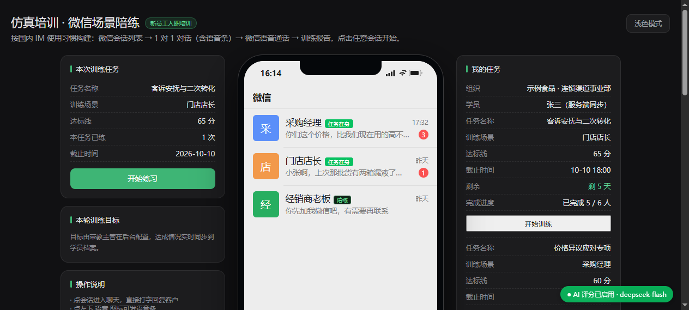
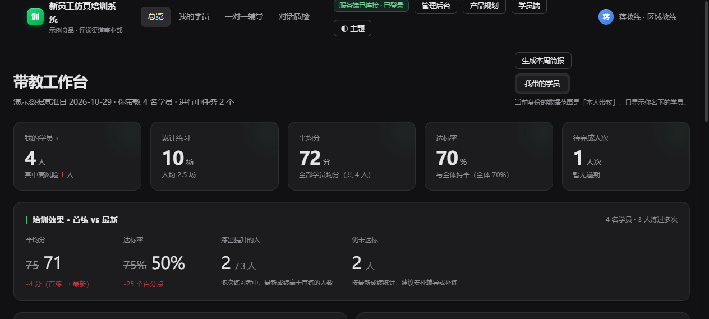
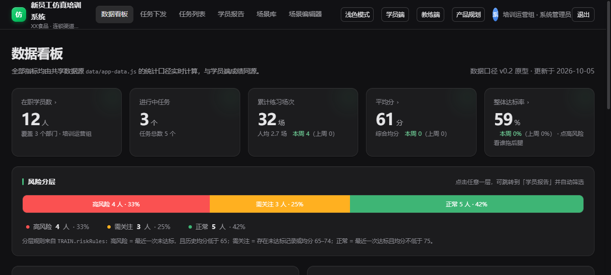

# 新员工仿真培训系统 V1.0

> 微信风格的销售话术人机对练：新人在仿真的微信对话里应对 AI 扮演的刁难客户，
> 每轮实时评分，练完出五维报告；带教主管看短板做辅导，运营下发任务管场景。

**纯静态前端 + 零依赖 Node 服务端**（无 npm 包、无 CDN、无网络字体），双击 HTML 就能跑；
服务端在线时数据落 SQLite，离线时自动回落本地种子数据，功能不中断。

`V1.0` · Node 22+ · SQLite · 零外部依赖 · 五维评分 · 三端协同

---

## 一眼看懂

| 学员端 | 教练工作台 | 运营后台 |
|---|---|---|
| 微信对话陪练、五维报告、进步对比 | 本组看板、待办原因、辅导抽屉 | 数据看板、任务下发、场景治理 |
|  |  |  |

---

## 快速开始

```bash
# 1. 启动服务端（零依赖，无需 npm install）
node server/index.js
# 或双击 start-server.bat

# 2. 打开页面
#    产品总览   http://127.0.0.1:8848/
#    学员端     http://127.0.0.1:8848/仿真培训原型-微信风格.html
#    教练台     http://127.0.0.1:8848/教练工作台-带教主管.html
#    运营后台   http://127.0.0.1:8848/管理后台-仿真培训.html
```

演示账号：`admin` / `admin123`（首次启动自动播种 3 场景 / 12 学员 / 5 任务 / 28 条成绩）。

**不启服务也能看**：直接双击 `仿真培训原型-微信风格.html`，全部交互走本地引擎与 localStorage。

---

## 三个角色怎么配合

```
运营：选场景 → 下发任务（达标线 / 截止时间）
   ↓
学员：收到任务 → 微信式对练（打字或按住说话）→ 每轮实时评分 → 交卷出报告
   ↓
教练：看本组看板 → 发现短板 → 写辅导记录（学员端可见）/ 标质检
   ↓
运营：看达标率与风险分层 → 补充场景 → 再下发
```

**关键闭环**：教练写的辅导记录会出现在学员端「带教留言」里；学员报告里有「和上次同场景对比」。
这两处不做，辅导就断在半路。

---

## 核心设计

**1. 双通道评分，降级不中断**
接大模型时走模型评分，未接时走内置关键词引擎；服务端不可达时整场回落前端本地引擎。
三种通道在界面上**如实标注**（`AI 评分` / `模拟通道` / `关键词引擎`），不把 mock 说成 AI。

**2. 评分口径只有一处**
`data/scoring-engine.js` 是前端与服务端共用的评分契约。前端算分与 `finish()` 落库口径一致，
学员看到的分和教练端查到的记录不会对不上。

**3. 内容治理闸门**
只有「已发布」场景能下发；已发布场景被修改会自动退回待审核；提交人不能审自己提交的场景。

**4. 数据可见范围**
`all / dept / mentor` 三档：管理员看全部、部门主管看本部、教练只看自己带教的学员。
范围判断集中在 `server/lib/core.js` 一处，避免各模块各写一套漏判。

**5. 演示时间可配**
`data/app-data.js` 的 `meta.demoNow` 是**三端共用的"今天"**。
演示数据是历史日期，若各端各用真实时间，同一个任务会同时显示"剩 5 天"和"已逾期 19 天"。
正式部署时置空即回落真实时间。

---

## 目录结构

```
├─ index.html                    产品总览（各端入口）
├─ 仿真培训原型-微信风格.html      学员端
├─ 教练工作台-带教主管.html        教练端
├─ 管理后台-仿真培训.html          运营端
├─ 产品规划-新员工培训系统.html     PRD
├─ data/                         共享数据层（前端/服务端同源）
│   ├─ app-data.js               种子数据 + 统计口径（helpers）+ 演示时间
│   └─ scoring-engine.js         评分引擎（前后端共用契约）
├─ assets/                       共享样式与适配层（shell.css / ai-bridge / sync）
├─ server/                       零依赖 Node 服务端
│   ├─ index.js                  路由入口
│   ├─ service.js                业务门面（229 行）
│   ├─ lib/                      领域模块：core / scenes / tasks / learners / records / coach
│   ├─ db.js                     建表、迁移、索引、播种
│   ├─ ai.js                     评分通道（大模型 / 关键词）
│   └─ tools/                    自测与运维脚本
├─ docs/                         文档、软著材料、参赛自查报告
└─ voice/                        可选的语音识别服务（见下）
```

---

## 自测

```bash
npm run test:all      # 评分引擎 35 + 模块检查 + 内联检查 + 服务端 223 + 前端 404
npm run test:e2e      # 移动端 390×844 布局与交互（13 项）
```

工具链里有两个专门防「静默坏掉」的检查：

- `check:modules` —— 直接 `require` 每个模块，检查导出是否真的存在（防漏 import 导致的 500）
- `check:inline` —— 抽取 HTML 里的 `onclick` 等属性，检查函数是否定义过（防"点了没反应"）

---

## 评分校准（可选）

接入真实模型后跑一次校准，看模型分与人工标注分的相关性：

```bash
LLM_API_KEY=sk-xxx node server/tools/calibrate.js
```

输出 `pearson` 与 `mae`：`pearson ≥ 0.60` 且 `mae ≤ 15` 才算可用于对外说明。

**已测结果**（2026-10-29，DeepSeek `deepseek-flash`，金标 30 条）：

| 通道 | pearson | mae | 结论 |
|---|---|---|---|
| 真实模型 deepseek-flash | **0.871** | **9.80** | 可用于对外说明 |
| 本地关键词引擎 / mock | 0.638 | 14.50 | 仅证明链路通，不可对外 |

未配置 Key 时脚本会明确标注「模拟通道」——不要把 mock 的相关系数当准确率。

---

## 语音输入（可选增强，非必需）

学员端支持「按住说话」，依赖本机 ASR 服务：

```bash
python voice/asr-server.py      # FunASR + SenseVoiceSmall，首次运行需下载约 900MB 模型
```

**不装也能用**：未检测到 ASR 服务时，语音按钮自动隐藏/降级为文字输入，练习流程完全不受影响。
评委复现时**不需要**部署语音服务。

---

## 已知限制

- **评分通道取决于是否配置 Key**：配置了 `LLM_API_KEY` 时走真实模型（已在 DeepSeek
  `deepseek-flash` 上完成校准：**n=30 / pearson 0.871 / mae 9.80**）；
  未配置时降级为关键词引擎，界面上会如实标注通道，不会把两者混为一谈。
- **规模未压测**：演示库 12 人 / 28 条成绩。索引按万级数据设计，但未做万级实测。
- **无 HTTPS**：默认 HTTP，正式对外需置于反向代理与证书之后。
- **无备份策略**：数据为单个 SQLite 文件，生产使用建议定期备份。

---

## 文档

- [文档地图](docs/README.md) —— 哪个文件是什么
- [服务端说明](server/README.md) —— 接口、分层、索引与踩坑
- [产品规划](产品规划-新员工培训系统.html) —— 需求与设计取舍
- [软著材料](docs/软著/申请材料清单.md) —— 源代码文档与用户手册的生成方式
- [参赛自查报告](docs/参赛自查报告-20261029.md) —— 本轮修复的问题清单

---

## 许可

本作品著作权归作者所有。源码公开用于**参赛评审、学习与交流**。

- 允许：阅读、学习、评审、非商业性复制与修改
- 未经书面许可不得：商业使用、再发布、衍生分发

商业授权请联系作者。
